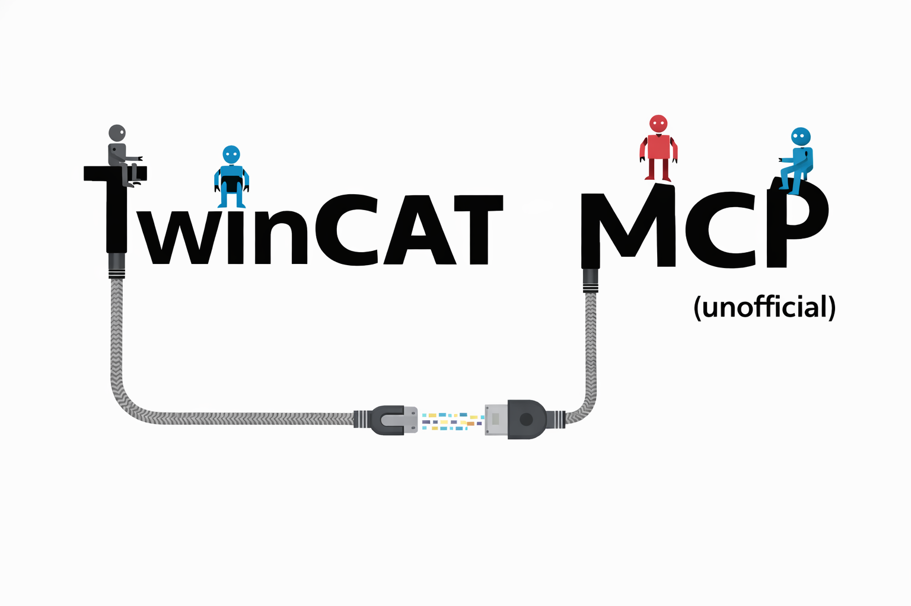

<p align="center">
  
</p>

# TwinCAT MCP Server v2

TwinCAT engineering, runtime diagnostics and workflows through three MCP tools.
The server targets MCP **2026-07-28** using the official Python SDK **2.2.0**.

| Public tool | Purpose |
| --- | --- |
| `twincat_search` | Find relevant operations and workflows; browse categories without loading every schema. |
| `twincat_describe` | Read full schemas, prerequisites and examples for up to five operation IDs. |
| `twincat_execute` | Validate and execute an operation, or inspect/cancel an existing job. |

The catalog contains 66 operations. Individual operations are **not separate MCP tools**.
Search does not dynamically register tools or change `tools/list`. The public execute
tool is conservatively annotated as potentially destructive; operation-specific
authorization is enforced by the server.

The application version is **2.3.0**. See the [release notes](CHANGELOG.md) for
changes and upgrade instructions. The supported interface consists of
the three public tools and the [operation catalog](docs/operations.md).

## Install

Requires Windows, Python 3.10+, TwinCAT XAE, Visual Studio MSBuild, the .NET
Framework 4.7.2 targeting pack and Beckhoff's `TcXaeMgmt` PowerShell module.
Optional Scope operations require TE13xx and an automation worker built with
Scope support. ADS recording does not require TE13xx.

```powershell
.\scripts\setup.ps1
.\scripts\install-mcp.ps1
```

Setup creates `.venv`, installs pinned direct dependencies, and builds
`TcAutomation/bin/Release-v2/TcAutomation.exe` with MSBuild. Reload the MCP server
through the client after installation.

For any stdio MCP client, use absolute paths:

```json
{
  "command": "C:/path/to/twincat-mcp/.venv/Scripts/python.exe",
  "args": ["C:/path/to/twincat-mcp/mcp-server/server.py"]
}
```

Use `install-mcp.ps1 -Workspace` to merge the entry into the current workspace's
VS Code configuration. Other server entries are preserved.

## Discover and execute

Call `twincat_search`:

```json
{"query": "read PLC variables"}
```

Call `twincat_describe`:

```json
{"operations": ["runtime.read_var_list"]}
```

Call `twincat_execute`:

```json
{
  "operation": "runtime.read_var_list",
  "arguments": {
    "amsNetId": "1.2.3.4.1.1",
    "port": 851,
    "symbols": ["MAIN.bRunning", "MAIN.nCount"]
  },
  "requestKey": "9454a153-481b-49ea-b749-cf1799ae7139"
}
```

The response contains a `jobHandle`, status and bounded progress. By default execute
waits up to one second for completion; `waitSeconds` can be 0–120. Small final
results are included inline. For unfinished work, wait without resubmitting:

```json
{"operation": "job.wait", "arguments": {"jobHandle": "<returned handle>", "waitSeconds": 120}}
```

Large results remain in the receipt store. Read `job.result` using `offset` and
`limit`; concatenate its JSON text pages. The default page is 8,000 characters,
with a 16,000-character maximum. No full schema catalog or unlimited log stream
is sent to the model.

`job.wait` returns the current receipt on timeout with `waitTimedOut:true`;
`job.get` inspects it immediately. Cancelling a wait leaves the job running.

Supply a **new UUID requestKey for each submitted operation**.
`system.status`, `context.status`, `safety.revoke`, `job.get`, `job.result` and
`job.cancel` return immediately. These operations and `job.wait` do not require
a request key. After a lost
response, resend exactly the same operation, arguments and key: the original
receipt is returned without executing again. A key with different arguments is
rejected. Intentional repeats require new keys. The receipt store retains keys
across restarts; deleting the database ends that protection.

## Engineering contexts and grants

Engineering operations use an explicit `contextHandle`. Open one with:

```json
{
  "operation": "context.open",
  "arguments": {
    "solutionPath": "C:/Projects/Machine/Machine.sln",
    "amsNetId": "1.2.3.4.1.1",
    "plcName": "PLC"
  },
  "requestKey": "<new UUID>"
}
```

Its completed job result returns the handle. The solution, PLC, target and optional
`tcVersion` are fixed for that context. One engineering context owns the persistent
shell per server process. A second context is rejected until the owner closes the
first with `context.close`. Worker loss invalidates the context. Handles from a
previous server process expire; no implicit replacement login is attempted.

Build with `engineering.build` and `{"contextHandle":"...","clean":false}`.
Use `clean:false` when preserving compile information for online change.
Build receipts include per-build output, compiler status and TMC artifact evidence.
Use `workflow.build_verify` with expected symbols or types to verify generated
content, and `engineering.symbols` to inspect it in pages. The
[build feedback guide](docs/build-feedback.md) covers linking policy, retained
artifacts and deadlines.
[Online-change workflow](docs/online-change.md) documents the retained-state requirements.
[Secure ADS route management](docs/ads-routes.md) documents fingerprint-verified
route recovery and protected credential files.

Operations marked `requiresGrant` need an explicit grant. After the user authorizes
the work in the calling host, execute `safety.grant`:

```json
{
  "operation": "safety.grant",
  "arguments": {
    "operations": ["workflow.deploy"],
    "contextHandle": "<context handle>",
    "reason": "User approved deployment to the designated test target",
    "ttlSeconds": 900
  },
  "requestKey": "<new UUID>"
}
```

Pass the returned `grantHandle` to the operation. High-impact operations also
require `confirm:"CONFIRM"` where their schema specifies it. Grants are scoped
to exactly one context, explicit AMS target, or Scope config path. They expire
after a fixed lifetime (default 900 seconds, maximum 3,600); calls do not refresh
them. `safety.revoke` revokes a grant immediately without a request key, including while a workflow is running. An already dispatched native command can finish; subsequent steps recheck the grant. Local runtime writes and test/deployment
workflows follow the same scoping rules as remote ones.

A grant is not authentication or proof of user approval. This is a local,
trusted stdio server; the calling host owns user consent and tool permissions.
Do not expose it as an unauthenticated network service.

## Workflows

| Workflow | Work performed by the server |
| --- | --- |
| `workflow.deploy` | Build, activate and restart through the existing C# deployment implementation. |
| `workflow.test` | Configure/run the TcUnit workflow and return its structured report. |
| `workflow.sequence` | Validate up to 32 catalog steps before effects, then execute in order and stop on failure. |
| `workflow.wait_state` | Poll runtime state with a configured interval and deadline. |
| `workflow.build_verify` | Build and verify explicit symbol/type expectations against the selected PLC's TMC. |

Sequences accept `steps:[{"operation":"...","arguments":{...}}]`; use catalog
operation IDs, not raw CLI commands. All steps carry their own required handles.
Nested sequences and control operations are prohibited. Partial results survive
failure or cancellation. Native COM calls may overrun the polling deadline;
the deadline stops further polls after the current call returns.

There is no arbitrary Python/JavaScript execution endpoint. Validated operations
and named workflows provide composition without introducing another scripting
runtime alongside PLC access.

## PLC objects and folders

Create and organize source through Automation Interface using
`engineering.create_folder` and `engineering.create_object`. Browse with
`engineering.list_objects`; read, update, rename and delete with explicit paths
and source/tree hashes. Native TwinCAT and PLCopen import/export support reusable
objects and folder hierarchies. Authoring runs offline; the online-change source
workflow remains separate.

`engineering.move_object` relocates existing objects or project folders with
native bytes, GUIDs and nested members preserved. It saves and reloads the owned
solution, with recovery records and guarded rollback. See
[moving objects](docs/moving-objects.md) for supported layouts and recovery.

The [PLC object guide](docs/plc-objects.md) covers supported types, grants, nested
folders, source updates, import/export formats, failure receipts and compilation.

## Jobs, cancellation and shutdown

Work runs on one bounded queue (64 waiting jobs) outside the protocol event loop.
Discovery and job inspection remain responsive while the worker is busy.
The native shell serializes solution selection and command dispatch together.

`job.cancel` cancels queued work or stops a workflow before its next dispatch.
An already dispatched native command may finish and cannot be rolled back.
Its actual outcome is retained with `cancelRequested:true`; cancellation is not
evidence that a PLC change did not occur. Closing a transport request does not
cancel a detached job. Use the explicit job handle.

Receipts are stored in `%LOCALAPPDATA%/twincat-mcp/jobs.sqlite3`. A server heartbeat
identifies abandoned work; after 30 seconds without its owner, unfinished jobs
become `outcome_unknown`. They are never automatically replayed. Scope
recordings also have explicit handles; stop them before closing the server.
On stdio EOF or client exit, the Python server closes its jobs and owned native
resources. On Windows, its watchdog follows the client through the Python venv
launcher and pins process identity. A healthy idle connection remains open.
The native watchdog and session janitor clean owned engineering processes using
verified process handles and start times. Unverified records are retained.

The database includes diagnostic data, source excerpts and operation handles.
It is local to the OS user. There is currently no automatic retention purge:
archive/delete it only while servers are stopped and after accepting loss of
request-key deduplication history.

## Configuration and testing

| Variable | Purpose |
| --- | --- |
| `TWINCAT_AUTOMATION_EXE` | Explicit worker executable; invalid paths fail without fallback. |
| `TWINCAT_MCP_STATE_DIR` | Override the receipt, native session-record and move-recovery directory, useful for isolated tests. |
| `TWINCAT_DISABLE_HOST=1` | Disable engineering/ADS worker dispatch; no CLI fallback. |
| `TWINCAT_MCP_PARENT_WATCHDOG=0` | Disable client-exit monitoring; stdio EOF still closes the server. |
| `TWINCAT_MCP_SHUTDOWN_GRACE_SECONDS` | Client-exit cleanup deadline, 1–120 seconds; default 60. |

Targets are explicit; provide the AMS Net ID when opening a context or calling
a runtime operation.

```powershell
.\scripts\test-mcp-automated.ps1
.\scripts\test-plc-objects.ps1
.\scripts\test-mcp.ps1
```

The automated suite uses fake workers, real stdio subprocesses and disposable
test-owned processes; it never writes to a PLC. Inspector can invoke real operations, so choose an appropriate
test target. Hardware qualification is separate from protocol tests.

[Architecture](docs/architecture-v2.md) explains discovery,
workflows and the current standards. [Contributing](CONTRIBUTING.md) covers development.
[TcForge](https://github.com/eponce00/TcForge) is the related reusable PLC library.

MIT. Independent project; not affiliated with or endorsed by Beckhoff Automation.
